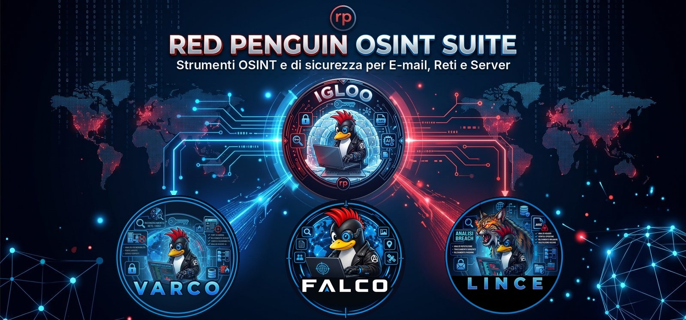
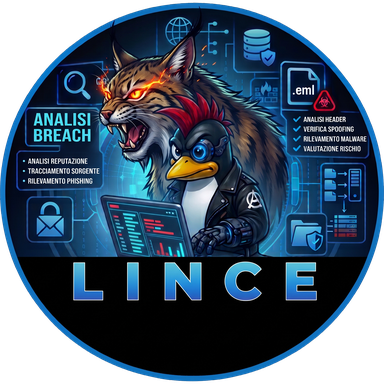
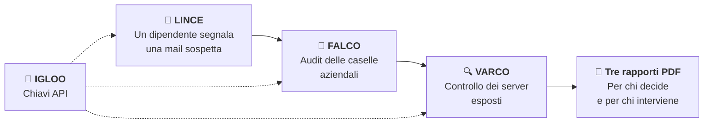

<div align="center">



# Red Penguin OSINT Suite

### Messaggi, persone, server: l'esposizione di un'azienda vista da tre lati

Tre programmi di analisi e un custode delle chiavi, con lo stesso tema e rapporti pronti per chi decide.

[](../../releases/latest)
[](docs/RedPenguinOSINTSuite_Scheda.pdf)


</div>

---

## 🧰 I programmi

### Il custode delle chiavi

| | Programma | A cosa serve | Versione |
|:--:|---|---|:--:|
|  | **IGLOO** | Custodisce in un unico posto le chiavi API di AI e servizi per tutta la suite, e le prova con un clic. |  |

### I programmi di analisi

| | Programma | Risponde alla domanda | Versione |
|:--:|---|---|:--:|
|  | **LINCE**<br><sub>Localizza Insidie Nascoste in Contenuti Elettronici</sub> | Questa mail, questo file, questa foto o questo link nascondono una trappola? |  |
|  | **FALCO**<br><sub>Forensic Analysis & Live Collection of OSINT</sub> | Quanto sono esposte le caselle e il dominio dell'azienda? |  |
|  | **VARCO**<br><sub>Verifica Attiva, Ricognizione e Classificazione Obiettivi</sub> | Quali servizi sono davvero raggiungibili sui server? |  |

---

## 🔗 Un caso, tre programmi



---

## ✨ Che cosa fa ogni programma

<details open>
<summary><b>🐆 LINCE: mail, file, foto, cartelle e link</b></summary>
<br/>

- 🎯 **Un solo campo:** indirizzo, messaggio `.eml`, file, foto, cartella, link o dominio, riconosciuti da soli
- ✉️ **Messaggi e PEC:** mittente reale, SPF/DKIM/DMARC, spoofing, percorso su un planisfero offline, marchi imitati
- 📁 **Cartelle intere:** ogni file controllato; i messaggi `.eml` letti come messaggi, con i loro allegati
- 🧩 **File e allegati:** tipo reale, estensioni false, macro, JavaScript nei PDF, script, archivi, steganografia e codici QR
- 🛡️ **VirusTotal senza regalare i dati:** prima l'impronta; un file parte solo se confermi, da cartelle e allegati mai
- 📄 **Rapporti:** PDF per chi decide, HTML tecnico a sezioni, TXT e JSON. Non apre mai file né link

</details>

<details>
<summary><b>🦅 FALCO: caselle e dominio</b></summary>
<br/>

- 💥 **Esposizione:** violazioni di dati da fonti gratuite, con gravità a regole fisse, log di infostealer e diffusione
- 🏢 **Audit aziendale:** tutte le caselle di un dominio da un elenco, con riepilogo per la direzione
- 📜 **Mandato e incarico:** PEC e autorizzazione firmata allegate, con impronte SHA-256 nel rapporto
- 🚦 **In sintesi:** semaforo e azioni urgenti; se una fonte non risponde il risultato è dichiarato parziale, mai verde
- 📈 **Confronto nel tempo:** come cambia la stessa casella tra un controllo e l'altro

</details>

<details>
<summary><b>🔍 VARCO: host e server</b></summary>
<br/>

- 🔌 **Porte e servizi:** le 21 porte più usate, tra cui FTP, SSH, SMB, RDP, database e web
- 🎯 **Verifica effettiva:** distingue la porta esposta dal servizio confermato sfruttabile
- 🌐 **Sito web:** header di sicurezza, certificato, SSL/TLS e file sensibili esposti
- 🛰️ **Fonti esterne:** Shodan e VirusTotal per CVE note e reputazione
- 📄 **Rapporto:** a fine scansione il PDF per chi decide si apre da solo

</details>

<details>
<summary><b>🧊 IGLOO: le chiavi della suite</b></summary>
<br/>

- 🗝️ **Un solo archivio per computer:** le chiavi si inseriscono una volta e valgono per tutti i programmi
- 🧪 **Prova delle chiavi:** valida, rifiutata o non verificabile; per le AI, quanti modelli sono disponibili
- 📋 **Catalogo pronto:** Gemini, Groq, DeepSeek, OpenRouter, HIBP, EmailRep, URLhaus, Shodan, VirusTotal e GitHub
- 📦 **Gli altri programmi:** al primo avvio propone di installare i `.deb` della suite trovati in Scaricati
- 🗂️ **Menu dedicato:** crea la categoria «Red Penguin OSINT Suite» nel menu principale

</details>

---

## 🤝 Cosa hanno in comune

| | | | |
|:--:|---|:--:|---|
| 🗝️ | **Chiavi condivise:** si gestiscono solo in IGLOO | 🌗 | **Tema giorno/notte:** una scelta valida per tutta la suite |
| 📦 | **Pacchetti autosufficienti:** ognuno funziona anche da solo | 📤 | **Import/export dei parametri:** mai le chiavi |
| 📚 | **Documentazione inclusa:** scheda, presentazione, manuale operativo e Credits per ogni programma | 🛑 | **Tasto Stop:** per interrompere le operazioni lunghe |
| 🤖 | **AI di supporto:** Gemini → Groq commentano, i giudizi restano a regole fisse | 🚫 | **Mai «verde» su ciò che non è stato controllato** |

---

## 🚀 Installazione

**1.** Dalla pagina [**Releases**](../../releases/latest) scarica i file `.deb` che ti servono nella stessa cartella.

**2.** Apri un terminale in quella cartella e installali:

```bash
sudo apt install ./*.deb
```

Se la cartella è nella tua home, alla fine apt può scrivere «Lo scaricamento è eseguito come root, ma non in una sandbox…»: è
solo un avviso, l'installazione è completa. Per non vederlo, copia prima i pacchetti in `/tmp` e installali da lì.

**3.** Apri **IGLOO** (comando `rp-igloo`) e inserisci le tue chiavi: Gemini e Groq sono gratuite e servono per l'AI. Gli altri programmi le leggeranno da soli.

> [!TIP]
> Con IGLOO installato trovi tutto nella categoria **Red Penguin OSINT Suite** del menu. Senza, i programmi sono in **Altro**.

> [!NOTE]
> **Aggiornamento dalla versione precedente** (Red Penguin Suite, Mail Sentinel): installa insieme i quattro pacchetti nuovi. IGLOO toglie da solo la vecchia categoria del menu e LINCE sostituisce Mail Sentinel mantenendone i parametri.

### 🪟 Windows

Ogni programma ha il suo `setup.exe` nella pagina [**Releases**](../../releases/latest): `IGLOO-1.2.3-setup.exe`,
`FALCO-1.7.4-setup.exe`, `LINCE-3.1.8-setup.exe`, `VARCO-1.0.6-setup.exe`. Dopo l'installazione li trovi nel menu Start,
cartella **Red Penguin OSINT Suite**, con i documenti in «NOME - documenti». Installa per primo **IGLOO**.

FALCO usa **Graphviz** per il grafo delle relazioni: va installato a parte da [graphviz.org](https://graphviz.org/download/).
Senza, FALCO funziona e salta solo il grafo.

> [!IMPORTANT]
> **Avviso dell'antivirus.** Su Windows alcuni motori antivirus possono segnalare come sospetti i `setup.exe` o i programmi
> installati. Sono **falsi positivi**: una reazione frequente ai programmi Python trasformati in eseguibile con **PyInstaller**
> e **non firmati digitalmente**. Il codice è quello pubblicato qui, con licenza MIT. A segnalare è una minoranza di motori (una
> manciata su circa 70), quasi tutti euristici o basati su machine learning; il referto pubblico di VirusTotal lo mostra. Puoi
> verificarlo tu stesso confrontando l'impronta **SHA-256** del file scaricato con quella qui sotto.

<details>
<summary><b>🔎 Verifica le impronte SHA-256 (release <code>suite-2026.11.17</code>)</b></summary>
<br/>

Calcola l'impronta del file e confrontala con la tabella, poi apri il referto VirusTotal.

- **Windows (PowerShell):** `Get-FileHash .\NOME_FILE.exe -Algorithm SHA256`
- **Linux:** `sha256sum NOME_FILE.exe`

| File | SHA-256 | VirusTotal |
|---|---|---|
| `IGLOO-1.2.3-setup.exe` | `b11b2974b4d9a7b73f78c4770d66e1d204f9343bf14a3185eb9261f7728049f7` | [Referto](https://www.virustotal.com/gui/file/b11b2974b4d9a7b73f78c4770d66e1d204f9343bf14a3185eb9261f7728049f7) |
| `IGLOO.exe` | `9bd9b06453b9ed53bbfc96a8f632523f4b45f1de295b468224826a0164783ea9` | [Referto](https://www.virustotal.com/gui/file/9bd9b06453b9ed53bbfc96a8f632523f4b45f1de295b468224826a0164783ea9) |
| `FALCO-1.7.4-setup.exe` | `a2445c1955223c345f1206172a1aac14e21d8c613bc67185fee883e58c1c5355` | [Referto](https://www.virustotal.com/gui/file/a2445c1955223c345f1206172a1aac14e21d8c613bc67185fee883e58c1c5355) |
| `FALCO.exe` | `2ce327dab58432e3408b12f7fcd62bd90e573f0a12fa619830d16da9277e2c8b` | [Referto](https://www.virustotal.com/gui/file/2ce327dab58432e3408b12f7fcd62bd90e573f0a12fa619830d16da9277e2c8b) |
| `LINCE-3.1.8-setup.exe` | `1cf33c96bff99b7a9450febac08c7108cb4b56d46cbdd086d17dded669c7ae2f` | [Referto](https://www.virustotal.com/gui/file/1cf33c96bff99b7a9450febac08c7108cb4b56d46cbdd086d17dded669c7ae2f) |
| `LINCE.exe` | `8833a74c1ce20a319378b85ae5962815f3a9d4a094b953441ffa64fd6044d4fb` | [Referto](https://www.virustotal.com/gui/file/8833a74c1ce20a319378b85ae5962815f3a9d4a094b953441ffa64fd6044d4fb) |
| `VARCO-1.0.6-setup.exe` | `6a11ea270447d0563af23fccfb578d299a4765cca81460b09f01024f11c97c56` | [Referto](https://www.virustotal.com/gui/file/6a11ea270447d0563af23fccfb578d299a4765cca81460b09f01024f11c97c56) |
| `VARCO.exe` | `329b4afeb9a9f481fa40abbb340961c65a2e1de5802f461ca3abe199b071c27c` | [Referto](https://www.virustotal.com/gui/file/329b4afeb9a9f481fa40abbb340961c65a2e1de5802f461ca3abe199b071c27c) |

Se un file viene bloccato: controlla che l'SHA-256 coincida, guarda il referto VirusTotal e — se vuoi — aggiungi un'eccezione,
oppure compila dai sorgenti. Al primo avvio Windows può anche mostrare l'avviso SmartScreen *«Windows ha protetto il PC»*
perché i file non sono firmati: verificato l'SHA-256, procedi con **Ulteriori informazioni → Esegui comunque**.

> Ogni nuova release produce file diversi, quindi SHA-256 diversi: fai sempre riferimento alla versione che stai usando.

</details>

---

## 📄 Documentazione

- [Scheda della suite, una pagina](docs/RedPenguinOSINTSuite_Scheda.pdf)
- [Scheda della suite, due pagine con i dettagli di ogni programma](docs/Red_Penguin_OSINT_Suite_Scheda.pdf)
- Scheda, presentazione, manuale operativo e Credits di ogni programma: nella pagina [Releases](../../releases/latest) e, dopo l'installazione, in `/usr/share/doc/<nome del pacchetto>/`

---

## ⚖️ Uso lecito

> [!WARNING]
> Usa questi programmi solo su sistemi, indirizzi e dati di cui sei responsabile o per cui hai un'autorizzazione scritta. L'autore declina ogni responsabilità per un uso non corretto o illegale del software.

> [!NOTE]
> **Servizi esterni e uso professionale.** I programmi sono gratuiti, ma i servizi che interrogano hanno regole proprie, e le
> chiavi sono tue:
> - **VirusTotal**: la chiave gratuita (API pubblica) è solo per uso non commerciale; per un servizio a pagamento o il lavoro per i
>   clienti serve l'abbonamento premium di VirusTotal.
> - **XposedOrNot**: l'API gratuita è per uso personale e a basso volume; l'uso commerciale dei dati richiede una licenza
>   (piani xonAPI+).
>
> Senza queste chiavi, o lasciandole vuote in IGLOO, i programmi saltano quei servizi e funzionano con gli altri.

---

<div align="center">

**🧩 Altri programmi Red-Penguin:** Transmute (Red Penguin Software), dai sorgenti Python al `setup.exe` per Windows · [github.com/Redpenguin67](https://github.com/Redpenguin67)

**📄 Licenza:** programmi MIT · loghi e grafica: tutti i diritti riservati

**✉️ Contatti:** [IamRedPenguin@proton.me](mailto:IamRedPenguin@proton.me)

<sub>Powered by Red-Penguin 🐧</sub>

</div>
