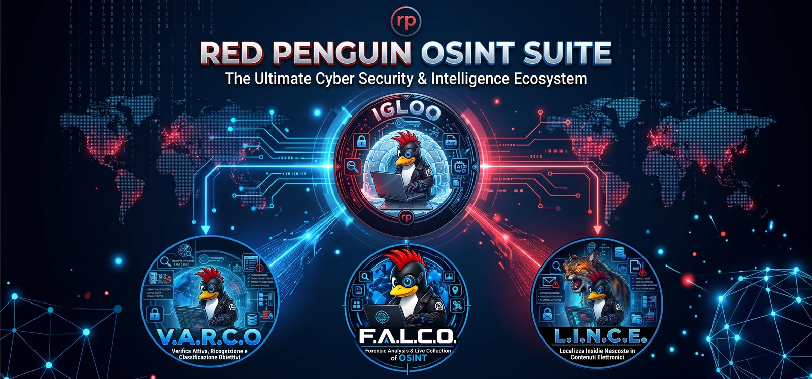
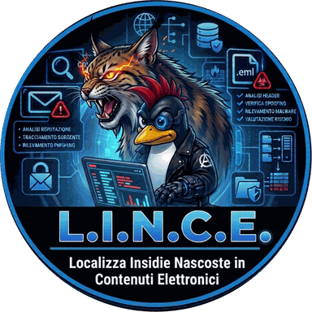
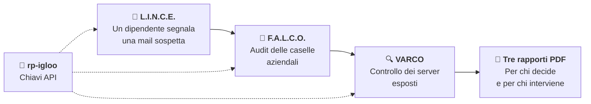

<div align="center">



# Red Penguin OSINT Suite

### Messaggi, persone, server: l'esposizione di un'azienda vista da tre lati

Tre programmi di analisi e un custode delle chiavi, con lo stesso tema e rapporti pronti per chi decide.

[](../../releases/latest)
[](docs/RedPenguinOSINTSuite_Scheda.pdf)


</div>

---

## 🧰 I programmi

### Il custode delle chiavi

| | Programma | A cosa serve | Versione |
|:--:|---|---|:--:|
|  | **rp-igloo** | Custodisce in un unico posto le chiavi API di AI e servizi per tutta la suite, e le prova con un clic. |  |

### I programmi di analisi

| | Programma | Risponde alla domanda | Versione |
|:--:|---|---|:--:|
|  | **L.I.N.C.E.**<br><sub>Localizza Insidie Nascoste in Contenuti Elettronici</sub> | Questa mail, questo file, questa foto o questo link nascondono una trappola? |  |
|  | **F.A.L.C.O.**<br><sub>Forensic Analysis & Live Collection of OSINT</sub> | Quanto sono esposte le caselle e il dominio dell'azienda? |  |
|  | **VARCO**<br><sub>Verifica Attiva, Ricognizione e Classificazione Obiettivi</sub> | Quali servizi sono davvero raggiungibili sui server? |  |

---

## 🔗 Un caso, tre programmi



---

## ✨ Che cosa fa ogni programma

<details open>
<summary><b>🐆 L.I.N.C.E.: mail, file, foto, cartelle e link</b></summary>
<br/>

- 🎯 **Un solo campo:** indirizzo, messaggio `.eml`, file, foto, cartella, link o dominio, riconosciuti da soli
- ✉️ **Messaggi e PEC:** mittente reale, SPF/DKIM/DMARC, spoofing, percorso su un planisfero offline, marchi imitati
- 📁 **Cartelle intere:** ogni file controllato; i messaggi `.eml` letti come messaggi, con i loro allegati
- 🧩 **File e allegati:** tipo reale, estensioni false, macro, JavaScript nei PDF, script, archivi, steganografia e codici QR
- 🛡️ **VirusTotal senza regalare i dati:** prima l'impronta; un file parte solo se confermi, da cartelle e allegati mai
- 📄 **Rapporti:** PDF per chi decide, HTML tecnico a sezioni, TXT e JSON. Non apre mai file né link

</details>

<details>
<summary><b>🦅 F.A.L.C.O.: caselle e dominio</b></summary>
<br/>

- 💥 **Esposizione:** violazioni di dati da fonti gratuite, con gravità a regole fisse, log di infostealer e diffusione
- 🏢 **Audit aziendale:** tutte le caselle di un dominio da un elenco, con riepilogo per la direzione
- 📜 **Mandato e incarico:** PEC e autorizzazione firmata allegate, con impronte SHA-256 nel rapporto
- 🚦 **In sintesi:** semaforo e azioni urgenti; se una fonte non risponde il risultato è dichiarato parziale, mai verde
- 📈 **Confronto nel tempo:** come cambia la stessa casella tra un controllo e l'altro

</details>

<details>
<summary><b>🔍 VARCO: host e server</b></summary>
<br/>

- 🔌 **Porte e servizi:** le 21 porte più usate, tra cui FTP, SSH, SMB, RDP, database e web
- 🎯 **Verifica effettiva:** distingue la porta esposta dal servizio confermato sfruttabile
- 🌐 **Sito web:** header di sicurezza, certificato, SSL/TLS e file sensibili esposti
- 🛰️ **Fonti esterne:** Shodan e VirusTotal per CVE note e reputazione
- 📄 **Rapporto:** a fine scansione il PDF per chi decide si apre da solo

</details>

<details>
<summary><b>🧊 rp-igloo: le chiavi della suite</b></summary>
<br/>

- 🗝️ **Un solo archivio per computer:** le chiavi si inseriscono una volta e valgono per tutti i programmi
- 🧪 **Prova delle chiavi:** valida, rifiutata o non verificabile; per le AI, quanti modelli sono disponibili
- 📋 **Catalogo pronto:** Gemini, Groq, DeepSeek, OpenRouter, HIBP, EmailRep, URLhaus, Shodan, VirusTotal e GitHub
- 📦 **Gli altri programmi:** al primo avvio propone di installare i `.deb` della suite trovati in Scaricati
- 🗂️ **Menu dedicato:** crea la categoria «Red Penguin OSINT Suite» nel menu principale

</details>

---

## 🤝 Cosa hanno in comune

| | | | |
|:--:|---|:--:|---|
| 🗝️ | **Chiavi condivise:** si gestiscono solo in rp-igloo | 🌗 | **Tema giorno/notte:** una scelta valida per tutta la suite |
| 📦 | **Pacchetti autosufficienti:** ognuno funziona anche da solo | 📤 | **Import/export dei parametri:** mai le chiavi |
| 📚 | **Documentazione inclusa:** scheda, presentazione, manuale operativo e Credits per ogni programma | 🛑 | **Tasto Stop:** per interrompere le operazioni lunghe |
| 🤖 | **AI di supporto:** Gemini → Groq commentano, i giudizi restano a regole fisse | 🚫 | **Mai «verde» su ciò che non è stato controllato** |

---

## 🚀 Installazione

**1.** Dalla pagina [**Releases**](../../releases/latest) scarica i file `.deb` che ti servono nella stessa cartella.

**2.** Apri un terminale in quella cartella e installali:

```bash
sudo apt install ./*.deb
```

**3.** Apri **rp-igloo** e inserisci le tue chiavi: Gemini e Groq sono gratuite e servono per l'AI. Gli altri programmi le leggeranno da soli.

> [!TIP]
> Con rp-igloo installato trovi tutto nella categoria **Red Penguin OSINT Suite** del menu. Senza, i programmi sono in **Altro**.

> [!NOTE]
> **Aggiornamento dalla versione precedente** (Red Penguin Suite, Mail Sentinel): installa insieme i quattro pacchetti nuovi. rp-igloo toglie da solo la vecchia categoria del menu e L.I.N.C.E. sostituisce Mail Sentinel mantenendone i parametri.

Su **Windows** ogni programma ha il suo `setup.exe`: si trova nel menu Start, cartella **Red Penguin OSINT Suite**.

---

## 📄 Documentazione

- [Scheda della suite, una pagina](docs/RedPenguinOSINTSuite_Scheda.pdf)
- [Scheda della suite, due pagine con i dettagli di ogni programma](docs/Red_Penguin_OSINT_Suite_Scheda.pdf)
- Scheda, presentazione, manuale operativo e Credits di ogni programma: nella pagina [Releases](../../releases/latest) e, dopo l'installazione, in `/usr/share/doc/<nome del pacchetto>/`

---

## ⚖️ Uso lecito

> [!WARNING]
> Usa questi programmi solo su sistemi, indirizzi e dati di cui sei responsabile o per cui hai un'autorizzazione scritta. L'autore declina ogni responsabilità per un uso non corretto o illegale del software. Per il lavoro con i clienti verifica i termini dei servizi gratuiti (VirusTotal, XposedOrNot).

---

<div align="center">

**🧩 Altri programmi Red-Penguin:** Transmute (Red Penguin Software), dai sorgenti Python al `setup.exe` per Windows · [github.com/Redpenguin67](https://github.com/Redpenguin67)

**📄 Licenza:** programmi MIT · loghi e grafica: tutti i diritti riservati

**✉️ Contatti:** [IamRedPenguin@proton.me](mailto:IamRedPenguin@proton.me)

<sub>Powered by Red-Penguin 🐧</sub>

</div>
